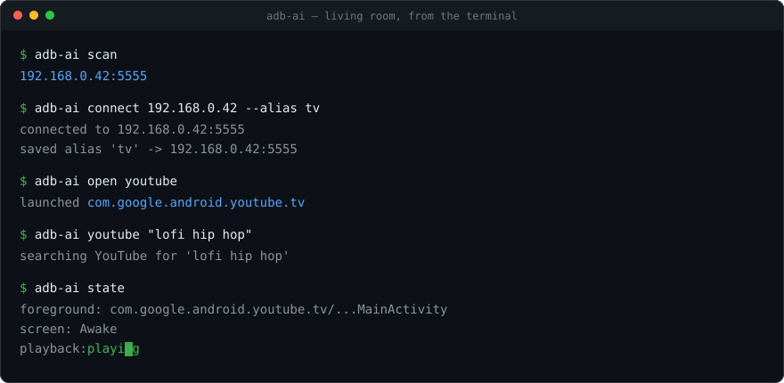
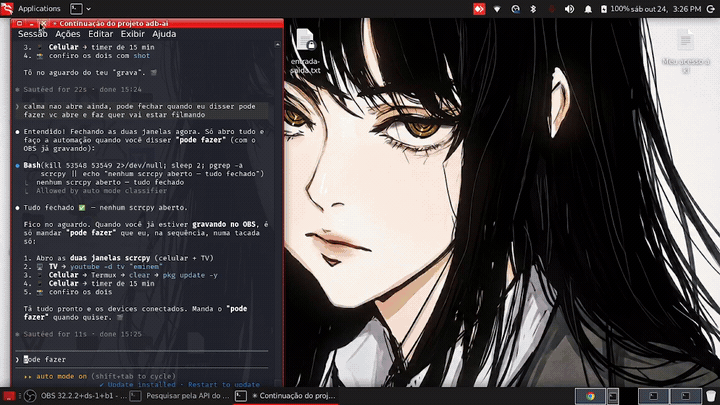

<p align="center">
  
</p>

<p align="center">
  🇧🇷 <strong>Feito com orgulho por brasileiros</strong> 🇧🇷
</p>

# ADB-AI 🇧🇷

**Você fala. A casa obedece.**

> *"põe o YouTube na TV"*
> *"pausa isso aí"*
> *"o que tá na tela da sala?"*
> *"põe um alarme às 7:30 no meu celular"*

O ADB-AI liga os aparelhos Android que você já tem — a TV, a TV box, o celular,
o tablet — ao agente de IA que você já usa. Você pede com as suas palavras; o
aparelho faz. Sem comprar hardware, sem conta na nuvem, sem app de fabricante:
só a ponte de depuração que o Android traz de fábrica há quinze anos, embrulhada
de um jeito que um agente consegue segurar o controle remoto.

É o mais perto de ter um Jarvis na sala que dá pra montar em cinco minutos, com
os aparelhos que já estão na sua casa.

[Instalação](docs/INSTALL.md) · [Tutorial](docs/TUTORIAL.md) · [O que dá pra fazer](docs/RECIPES.md) · [Usar com IA](docs/AGENTS.md) · [Como funciona](docs/HOW-IT-WORKS.md) · [Problemas](docs/TROUBLESHOOTING.md) · [English](README.md)



### Dois aparelhos ao mesmo tempo

O agente pesquisa "eminem" no YouTube da TV enquanto, no celular, abre o Termux,
roda `pkg update` e põe um timer de 15 minutos — tudo na mesma sessão.



Um pacote Python sem dependência nenhuma, igual no Windows, Linux, macOS e
Termux, com três portas de entrada:

- um **servidor MCP** — pro Claude, Codex, Cursor ou qualquer coisa que fale
  MCP. É esse que faz as frases lá de cima funcionarem.
- uma **skill do Claude Code** — a mesma coisa, pra quem prefere que o agente
  dirija a linha de comando.
- uma **CLI** que funciona sozinha: `adb-ai open netflix`. Dá pra usar em script, e
  serve pra você conferir que algo funciona antes de deixar um agente mexer.

> A documentação detalhada está em inglês para alcançar mais gente. Este arquivo
> cobre o essencial em português; os comandos são os mesmos.

## O que você precisa

Duas coisas — e o `adb-ai doctor` confere as duas pra você a qualquer momento:

1. **Python 3.9 ou mais novo**
2. **O binário `adb`** (Android platform-tools) — *não* é um pacote Python, por
   isso o `requirements.txt` não tem nenhuma dependência dentro

| Sistema | Como instalar o adb |
|---|---|
| Windows | `winget install Google.PlatformTools` |
| macOS | `brew install android-platform-tools` |
| Debian/Ubuntu | `sudo apt install adb` |
| Fedora | `sudo dnf install android-tools` |
| Arch | `sudo pacman -S android-tools` |
| Termux (Android) | `pkg install android-tools python` |

**Opcional: `scrcpy`** — só pra `adb-ai mirror` e `adb-ai record`, que mostram
a tela do aparelho ao vivo numa janela. Nada mais depende dele.

| Sistema | Como instalar o scrcpy |
|---|---|
| Windows | `winget install Genymobile.scrcpy` |
| macOS | `brew install scrcpy` |
| Debian/Ubuntu | `sudo apt install scrcpy` |
| Fedora | `sudo dnf install scrcpy` |
| Arch | `sudo pacman -S scrcpy` |
| Termux (Android) | **não funciona** — veja abaixo |

**No Termux o scrcpy não roda.** Não está no repositório padrão, e o caminho do
X11 (x11-repo + app Termux:X11) também não resolve — espelhar um celular no
próprio celular não é pra isso que a ferramenta serve. O `adb-ai` avisa isso em
português claro em vez de te entregar um erro de SDL, e todo o resto funciona
normal: no celular, quem mostra a tela é o `adb-ai shot`. Pra espelhar, rode o
`adb-ai` de um desktop na mesma rede.

## Instalação

```bash
git clone https://github.com/cyberpunk2183/adb-ai
cd adb-ai
./install.sh        # Linux, macOS, Termux — instala o que faltar, perguntando antes
.\install.ps1       # Windows (PowerShell)
```

Use `--check` (`-Check` no Windows) pra só ver o que falta, sem mexer em nada.
Sem instalar também funciona: `python -m adbai ...` roda direto da pasta.

## Ligar a depuração no aparelho

É aqui que todo mundo trava. **Nada conecta antes disso.**

**Android TV / TV box:** Configurações → Preferências do dispositivo → Sobre →
clique em **Versão** sete vezes → volte → **Opções do desenvolvedor** → ative
**Depuração por rede** (ou *Depuração ADB*/*USB*, conforme o aparelho).

**Celular/tablet:** Configurações → Sobre → toque em **Número da versão** sete
vezes → Opções do desenvolvedor → **Depuração sem fio**. No Android 11+ precisa
parear uma vez, e o caminho mais curto é pela câmera:

```bash
adb-ai pair            # desenha um QR; o celular lê e pareia sozinho
adb-ai pair --mirror   # o mesmo, e a tela abre assim que conectar
```

No celular: *Depuração sem fio → Parear usando QR code*. Não se digita nada —
nem IP, nem porta, nem os seis dígitos. Pareia e conecta de uma vez.

O `--mirror` emenda direto no scrcpy: um celular novo sai do QR code para uma
janela na sua mesa em um comando só. Vale igual em `adb-ai scan --mirror` e
`adb-ai connect <ip> --mirror`. O scrcpy é opcional, então quando ele falta —
e no Termux, onde não roda de jeito nenhum — o pareamento é informado do mesmo
jeito e só a janela fica de fora.

Dá pra parear digitando também: `adb-ai pair IP:PORTA CÓDIGO`, com o IP:porta
que aparece **dentro** do diálogo do código, que é diferente do de cima.

Se der `protocol fault`, seu `adb` foi compilado sem mDNS (é o caso do Termux)
e **nenhuma das duas formas funciona nesse binário**: confira com
`adb mdns check` e veja a [solução](docs/TROUBLESHOOTING.md).

Na primeira conexão **o aparelho mostra um aviso** perguntando se permite este
computador. Marque *Sempre permitir* e aceite — sem isso não conecta.

## Primeiros comandos

```bash
adb-ai doctor                             # está tudo certo?
adb-ai scan                               # acha o aparelho na rede
adb-ai connect 192.168.0.42 --alias tv    # conecta e salva o apelido "tv"

adb-ai open youtube                       # abre app por apelido, pacote ou pedaço do nome
adb-ai youtube "lofi hip hop"             # busca sem brigar com o teclado da tela
adb-ai key down down ok                   # sequência de teclas (controle remoto)
adb-ai tap 603 1311                       # toque, pra celular e tablet
adb-ai scroll down                        # rolar a tela
adb-ai text "oi"                          # digita no campo que está em foco
adb-ai alarm 7:30 --label "Academia"      # alarme (celular/tablet; TV não tem relógio)
adb-ai timer 10m                          # timer
adb-ai volume up -n 3
adb-ai state                              # o que está na tela e se está tocando
adb-ai shot tela.png                      # screenshot
adb-ai mirror                             # vê a tela ao vivo (precisa de scrcpy)
adb-ai record sessao.mp4                  # grava a tela, sem janela
adb-ai off                                # apaga a tela
```

**O IP vai mudar.** É DHCP: a TV que era `.42` ontem pode ser `.60` hoje. Deu
*No route to host*? Roda `adb-ai scan` e conecta de novo — é pra isso que o
`scan` existe.

## Plugar no seu agente

É pra isso que o projeto existe: uma linha, e seu agente controla seus
aparelhos.

**Claude Code**

```bash
claude mcp add adb-ai -- adb-ai mcp
```

**Claude Desktop** — `claude_desktop_config.json`

```json
{ "mcpServers": { "adb-ai": { "command": "adb-ai", "args": ["mcp"] } } }
```

**Codex CLI** — `~/.codex/config.toml`

```toml
[mcp_servers.adb_ai]
command = "adb-ai"
args = ["mcp"]
```

**Cursor** — `~/.cursor/mcp.json`

```json
{ "mcpServers": { "adb-ai": { "command": "adb-ai", "args": ["mcp"] } } }
```

Qualquer outro cliente MCP segue o mesmo formato. Chegam 22 ferramentas: achar
na rede, conectar, teclas, toques, apps, URLs, busca no YouTube, alarme, timer,
volume, liga/desliga, estado, print (que volta como imagem pro modelo olhar),
espelho da tela pra você acompanhar ao vivo, e shell.

**Skill do Claude Code:**

```bash
mkdir -p ~/.claude/skills && cp -r skills/adb-ai ~/.claude/skills/
```

Aí é só falar: *"põe o YouTube na TV"*, *"pausa isso aí"*, *"o que tá na tela da
sala?"*.

O `adb_shell` roda **qualquer** comando no aparelho — `dumpsys`, `pm`, `am`,
`settings`, `content` — como usuário shell, sem root. Isso é de propósito: é o
que permite ao agente fazer o que as outras ferramentas não cobrem. Também
é a única que pode mexer no aparelho de um jeito que você não pediu; se for
demais pro seu caso, desligue com `"env": {"ADBAI_NO_SHELL": "1"}` na
configuração do MCP.

## Por que não usar o `adb` direto?

- **O DHCP troca o IP dos aparelhos** — o `scan` acha de novo, com sockets
  puros, sem nmap, igual no Windows e no Termux.
- **Tem aparelho que corrompe a própria screenshot** — várias TVs Android
  imprimem lixo do driver antes do PNG; o `shot` sempre corta até o cabeçalho.
- **Nem todo aparelho tem `grep` que funcione** — a leitura é feita em Python
  no seu computador. Só o `state`, que é o comando que um agente mais usa, tenta
  primeiro o `grep` do aparelho e cai sozinho pro jeito lento quando não dá —
  nada *depende* de pipe no aparelho.
- **Nomes de tecla e de pacote são impossíveis de decorar** — `adb-ai key ok` em
  vez de `adb shell input keyevent KEYCODE_DPAD_CENTER`.
- **"Funcionou?"** — `adb-ai state` responde numa chamada só.

## Limites, responsabilidade e aviso legal

Isto é um controle remoto, não um desbloqueio. Serve para aparelhos **seus**,
com depuração ligada por você, na **sua** rede. Não contorna DRM, paywall nem
restrição de conta. E não alcança aparelho que ninguém abriu: a depuração ADB
fica atrás de um menu escondido e de um aviso que alguém precisa aceitar na
tela do próprio aparelho, presencialmente.

Dito isso — **qualquer ferramenta que controla aparelhos pela rede pode ser mal
usada**, e esta não é exceção: o `scan` varre uma faixa de rede, e controlar
muitos aparelhos é esta ferramenta num laço. Os autores não apoiam esse uso e
não se responsabilizam por ele. Leia o **[DISCLAIMER.md](DISCLAIMER.md)** antes
de usar. Em resumo:

- use só em aparelhos que são seus ou que você tem autorização para administrar;
- **ADB por TCP não tem autenticação** depois de autorizado — nunca exponha a
  porta 5555 na internet e desligue a depuração quando terminar;
- vem **sem garantia nenhuma**: você roda, você assume o resultado.

**Apontar isso para um celular é uma decisão bem maior que apontar para uma
TV.** Acesso ADB a um celular é o mesmo alcance que você tem com ele destravado
na mão: qualquer app, qualquer campo de texto, print de qualquer coisa na tela —
inclusive código de 2FA. Leia
[Phones are not TVs](DISCLAIMER.md#phones-are-not-tvs).

Política de segurança e checklist: **[SECURITY.md](SECURITY.md)**.

## Licença

MIT © 2026 cyberpunk2183 🇧🇷
