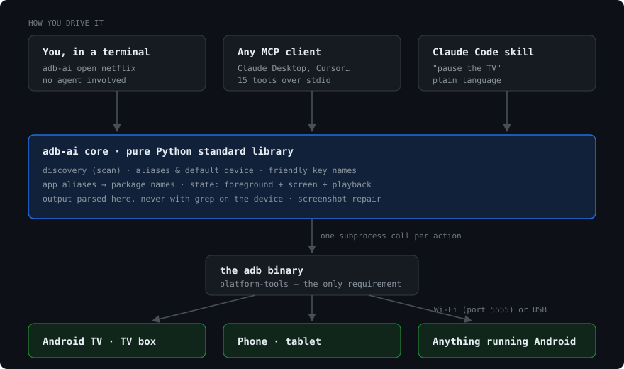

# How it works



adb-ai is a few hundred lines of Python around one external program, `adb`.
There is no daemon, no background service and no network protocol of its own:
every command starts a process, talks to the device, and exits.

## The pieces

| Module | Job |
|---|---|
| `adb.py` | find the adb binary, run it, list/connect devices, scan the network, capture screenshots |
| `target.py` | decide which device a command applies to, and reconnect it if needed |
| `config.py` | the default device and your aliases, in one JSON file |
| `keys.py` | friendly key names → Android keycodes |
| `apps.py` | "netflix" → `com.netflix.ninja`, against what is really installed |
| `actions.py` | the verbs: press, type, open, url, state, volume, sleep/wake |
| `cli.py` | argument parsing and human-readable output |
| `mcp_server.py` | the same verbs, exposed as MCP tools over stdio |
| `doctor.py` | check the environment and explain what is missing |

The three front ends are deliberately thin: the CLI, the MCP server and the
skill all call the same functions in `actions.py`. A fix in one is a fix in all
three.

## What a command actually does

`adb-ai open netflix` becomes, roughly:

1. `target.resolve()` — alias, `ADBAI_DEVICE`, stored default, or the single
   connected device. If the chosen device is a network address that is not
   connected, it runs `adb connect` first.
2. `apps.resolve("netflix")` — `adb shell pm list packages`, then match: exact
   package, then the alias table, then a fragment search.
3. `adb shell monkey -p com.netflix.ninja -c android.intent.category.LAUNCHER 1`

Everything is a subprocess call with an argument list — never a shell string —
so spaces, quotes and apostrophes behave the same on every platform.

## Decisions that are not obvious

**No dependencies, on purpose.** This often runs on a phone (Termux), a Raspberry
Pi or a locked-down work laptop. `pip install` of a dependency tree is exactly
the step that fails there. Everything is standard library, which is also why
`requirements.txt` has no packages in it — the one real requirement is `adb`,
which is not a Python package at all.

**Filtering happens on your machine.** The obvious way to read device state is
`adb shell "dumpsys window | grep mCurrentFocus"`. It is also fragile: plenty of
Android builds ship a crippled `grep` or none at all, and some environments (a
broken Termux `grep`, for one) fail in confusing ways. adb-ai pulls the whole
`dumpsys` output and parses it in Python. Slightly more bytes over the wire,
and it works everywhere.

**Screenshots are repaired.** Several Android TV firmwares print driver noise on
stdout before the PNG:

```
Init wrapper sys mutex successful. Pid:1234
open mma dev failed
<PNG bytes>
```

Save that straight to a file and you get a corrupt image — a genuinely
confusing bug. `adb.screencap()` always finds the `\x89PNG` magic bytes and
discards everything before them. It also falls back from `exec-out` to `shell`
for older devices, undoing the CRLF mangling that transport adds.

**Discovery with plain sockets.** `adb-ai scan` opens a TCP connection to port
5555 on every address of your subnet, 128 at a time, with a short timeout. No
nmap, no root, no ping (which is often blocked), and identical behaviour on
Windows, macOS, Linux and Android. The local subnet is found by opening a UDP
socket toward a public address and asking the OS which interface it would use —
no packet is actually sent.

**App aliases prefer the TV build.** `com.google.android.youtube.tv` comes
before `com.google.android.youtube`, because a device in a living room usually
has the former. The table only ever selects from packages that are installed,
so a wrong guess fails loudly instead of launching the wrong thing.

**State over screenshots.** An agent can take a picture and look at it, but
`adb-ai state` answers "did it work?" in one call, as text: foreground
activity, screen wakefulness, and the playback state of the active media
session (`state=3` means playing). It is faster, cheaper and unambiguous.

## Limits

- **ADB over TCP has no authentication** beyond the one-time "allow this
  computer" dialog. Treat an enabled device as open to everyone on that network.
- **One device per command.** There is no fan-out to several devices at once;
  loop in your shell if you need it.
- **No audio or video streaming.** This is a remote control, not
  [scrcpy](https://github.com/Genymobile/scrcpy) — if you want the screen
  mirrored and clickable, use scrcpy and come back here for automation.
- **Not every device exposes everything.** Some TVs ignore `KEYCODE_POWER`,
  some report no media session at all. `adb-ai doctor` and `adb-ai state` tell
  you what you are dealing with.
