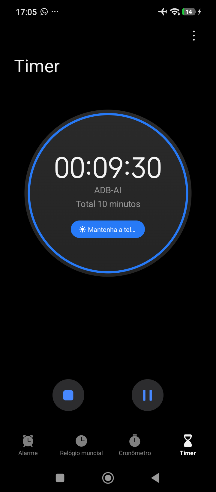
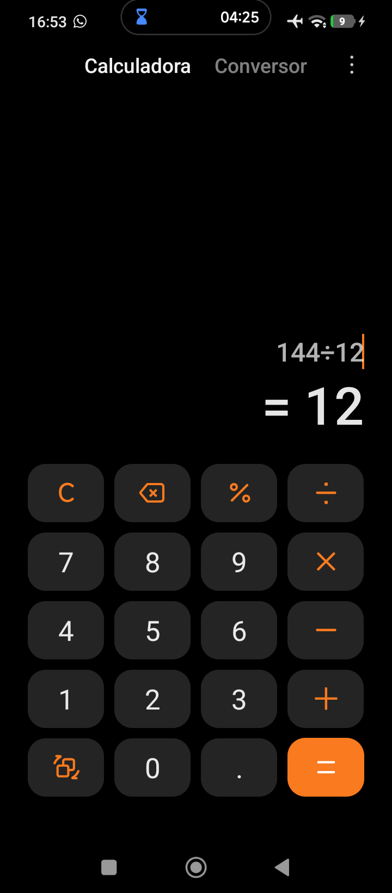
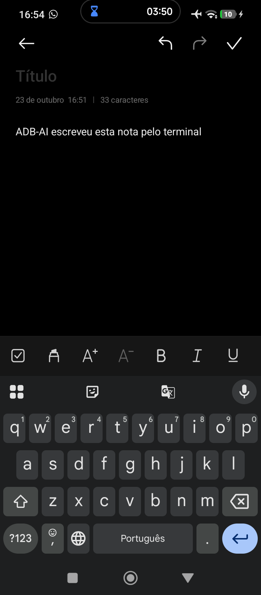

# What you can actually do with it

Everything below is a real command. Where a feature depends on the device,
it says so — a TV is not a phone, and both lie about some things.

> Notes marked **TV** come from running these against a 2020-era Android TV set
> over Wi-Fi; phones behave differently where said.

- [Watch something](#watch-something)
- [Volume and sound](#volume-and-sound)
- [Power and screen](#power-and-screen)
- [Navigate like a remote](#navigate-like-a-remote)
- [Alarms and timers](#alarms-and-timers)
- [Screenshots](#screenshots)
- [Knowing what is happening](#knowing-what-is-happening)
- [Several devices at once](#several-devices-at-once)
- [Things that will not work](#things-that-will-not-work)

---

## Watch something

The Android TV launcher, captured over the network with `adb-ai shot` — this is
the "menu" you are driving when you send `home`, `down` and `ok`:


```bash
adb-ai open youtube                  # by alias
adb-ai open com.netflix.ninja        # by package
adb-ai open youcine                  # by fragment of the package name
adb-ai apps                          # what is installed here
adb-ai close netflix                 # force-stop
```

Search without touching the on-screen keyboard — this is the single biggest
time-saver:

```bash
adb-ai youtube "lofi hip hop radio"
```

Deep links work for anything that registers one:

```bash
adb-ai url "https://www.netflix.com/title/80100172"
adb-ai url "spotify:playlist:37i9dQZF1DXcBWIGoYBM5M" --app com.spotify.tv.android
adb-ai url "https://www.primevideo.com/detail/0M1PFJ..."
```

Then press play, because launching an app does not start playback:

```bash
adb-ai key ok          # most TV apps resume on OK
adb-ai key play
adb-ai state           # playback: playing  <- the proof
```

## Volume and sound

```bash
adb-ai volume up -n 5
adb-ai volume down -n 3
adb-ai volume mute          # toggles
adb-ai volume set 12        # exact level on the media stream
```

**TV:** `up`/`down`/`mute` are key presses and always work. `set` uses the media
session and is ignored by some TV firmwares — check with `adb-ai state` or your
ears. On phones it is reliable.

## Power and screen

```bash
adb-ai off      # screen to sleep - the safe "turn it off"
adb-ai on       # wake
adb-ai key power
```

`off` sends `KEYCODE_SLEEP`, which is idempotent: running it twice leaves the
device asleep. `KEYCODE_POWER` toggles, so it can wake a device you meant to
turn off — prefer `off`/`on` in scripts.

**TV:** many sets drop off the network in standby, so after `off` the next
command may need a `scan` and `connect`. That is the TV, not the tool.

## Navigate like a remote

```bash
adb-ai key home
adb-ai key back
adb-ai key down down ok      # a sequence, left to right
adb-ai key right -n 4        # repeat
adb-ai keys                  # all ~50 names
```

Names: `home` `back` `ok` `up` `down` `left` `right` `menu` `search` `apps`
`settings` `play` `pause` `playpause` `stop` `next` `prev` `forward` `rewind`
`captions` `volup` `voldown` `mute` `power` `sleep` `wake` `tv` `input`
`channelup` `channeldown` `guide` `info` `red` `green` `yellow` `blue`, digits
`0`–`9`, plus any raw `KEYCODE_*`.

Typing into a focused field:

```bash
adb-ai text "my login@example.com"
```

## Alarms and timers

```bash
adb-ai alarm 7:30 --label "Work"
adb-ai alarm 6:45 --days mon,tue,wed,thu,fri --label "Gym"
adb-ai timer 10m --label "Pizza"
adb-ai timer 1h30m
adb-ai alarms                 # open the clock app's list
```

A timer started from the terminal, running in the phone's clock app with the
label it was given:



**Phones and tablets only.** Android TV ships a stub that accepts the alarm
intent and silently throws it away, so "it worked" would be a lie — ADB-AI
checks for a real clock app first and refuses with an explanation instead:

```console
$ adb-ai alarm 7:30
adb-ai: this device has no clock app that can hold an alarm - Android TV
accepts the request and silently drops it. Alarms and timers work on phones
and tablets.
```

By default the alarm is created silently (`SKIP_UI`). Pass `--confirm` to open
the clock app and let a human confirm it instead.

**Creating is easy; cancelling is not.** Android has `DISMISS_ALARM` and
`DISMISS_TIMER` intents, but clock apps are free to ignore them and many do —
AOSP's own deskclock answers `Activity not started, unable to resolve Intent`.
So an alarm set through ADB-AI may have to be deleted by hand in the clock app.
Worth knowing before you let an agent set them freely: `adb-ai alarms` opens the
list, and deleting is a human's job.

> **Pointing this at a phone is a bigger decision than pointing it at a TV.**
> Alarms live on phones, and ADB access to a phone is the same reach you have
> when it is unlocked in your hand: opening your bank or your messages, typing
> into them, and screenshotting whatever is on screen — including one-time
> codes. Read **[Phones are not TVs](../DISCLAIMER.md#phones-are-not-tvs)**
> before you enable debugging on your daily driver. A spare phone or an old
> tablet is a much better place to experiment.

## Phones: touch, not a d-pad

A TV is navigated with the d-pad; a phone is navigated by touch. Both are here.

```bash
adb-ai size                      # 720x1640 - coordinates come from this
adb-ai tap 603 1311
adb-ai swipe 360 1200 360 400    # scroll up by dragging
adb-ai swipe 360 800 360 800 --ms 800   # same point twice = long press
adb-ai scroll down               # or up / left / right, no coordinates needed
```

The honest workflow for coordinates: take a screenshot, find the button in it,
tap it. An agent does exactly the same — `adb_screenshot` then `adb_tap`.

Here is the calculator driven entirely by taps, `144 ÷ 12`, with the result on
screen:



And a note typed into the notes app with `adb-ai text`:



**Check the foreground before typing.** `adb-ai text` goes to whatever has
focus right now — and on a phone someone is holding, that can change between
two commands. `adb-ai state` first, then type.

## Screenshots

```bash
adb-ai shot                      # saves screen.png
adb-ai shot living-room.png
adb-ai shot - > /tmp/now.png     # straight to stdout
```

Two things ADB-AI handles for you:

- Some firmwares print driver noise before the PNG. Saved naively, the file is
  corrupt. ADB-AI always cuts to the PNG header. **TV:** this is exactly what
  that Philips does.
- Old devices without `exec-out` fall back to `shell`, with the CRLF mangling
  undone.

**Protected content comes back empty.** Live TV inputs, Netflix playback and
anything else under HDCP/DRM return zero bytes — that is Android refusing, not
a bug here:

```console
$ adb-ai shot            # while on the live TV input
adb-ai: no PNG in screencap output: empty response
```

Go to the launcher (`adb-ai key home`) and the screenshot works again.

## Knowing what is happening

```bash
adb-ai state
adb-ai state --json
adb-ai devices
adb-ai doctor
```

```console
$ adb-ai state
device:     192.168.0.42:5555
foreground: com.google.android.tvlauncher/com.google.android.tvlauncher.MainActivity
screen:     Awake
playback:   no media session
```

- `foreground` — which app and activity has focus. `unknown (transition?)` for a
  second after switching apps; ask again.
- `screen` — `Awake`, `Asleep`, `Dozing`.
- `playback` — from the active media session. `playing`, `paused`, `buffering`,
  or `no media session`. **An app being open is not playback.**

## Several devices at once

```bash
adb-ai alias tv 192.168.0.42
adb-ai alias quarto 192.168.0.60
adb-ai alias                       # list them

adb-ai -d quarto key pause
adb-ai -d tv open youtube
adb-ai use tv                      # change the default
```

Good night, everything:

```bash
for device in tv quarto cozinha; do adb-ai -d "$device" off; done
```

## When it feels slow

Two knobs, both earned the hard way:

```bash
adb-ai key down down ok             # one adb call for all three - the default
adb-ai key down down ok --pace 120  # one call per key, 120ms apart
```

Keys go in a single call because that is the difference between a remote that
feels instant and one that does not. A menu that animates between items can
drop keys that arrive together — if a sequence lands one step short, `--pace`
is the fix.

```bash
adb-ai shot big.jpg --max-size 1024   # scale it down (needs ffmpeg)
```

For your own eyes a full-size PNG is fine. For an agent it is not: a 4K screen
with artwork on it is megabytes that have to reach the model before it can say
anything, so the MCP server scales those down automatically when ffmpeg is
installed. A settings screen stays untouched — flat colours are already tiny as
PNG, and re-encoding one costs more time than it saves.

## Watching the screen

Screenshots answer "what is on screen now?". When you want to *watch* — follow
an agent while it works, or just use the TV from your desk — `adb-ai mirror`
opens a window with [scrcpy](https://github.com/Genymobile/scrcpy) and gives
you the mouse and keyboard too:

```bash
adb-ai mirror                       # the default device, in a window
adb-ai -d tv mirror --view-only     # look, do not touch
adb-ai mirror --max-size 1024       # smaller stream, for a slow network
adb-ai mirror --stay-awake --screen-off   # drive a phone with its screen dark
adb-ai mirror -- --crop 1080:1080:0:0     # anything after -- goes to scrcpy
```

Recording needs no window at all, which makes it the one that works over SSH:

```bash
adb-ai record session.mp4           # Ctrl-C to stop
adb-ai record demo.mp4 --seconds 30 --no-audio
```

Two things to know before you reach for it:

- **scrcpy is optional and separate.** `adb-ai doctor` says whether it is
  there, and how to install it if not. Nothing else in adb-ai needs it.
- **It does not work from Termux.** Not in the default repo, and the X11 route
  does not get there either. adb-ai tells you so instead of letting scrcpy fail
  with an SDL error. On a phone, `adb-ai shot` is how you see a screen; to
  mirror, run adb-ai from a desktop on the same network.

On a TV, mirroring works but the mouse mostly does not — there is no
touchscreen behind it. Use the arrow keys in the window, or keep using
`adb-ai key`.

## The shell, for everything else

Twenty tools cover the remote control. `adb-ai shell` covers the rest of
Android:

```bash
adb-ai shell "dumpsys battery"                     # charge, health, temperature
adb-ai shell "getprop ro.product.model"            # what is this device?
adb-ai shell "settings get system screen_off_timeout"
adb-ai shell "dumpsys deviceidle | head -20"
adb-ai shell "pm list packages -d"                 # disabled packages
adb-ai shell "am start -a android.settings.WIFI_SETTINGS"
adb-ai shell "wm size" ; adb-ai shell "wm density"
adb-ai shell "cmd notification post -S bigtext tag 'Dinner is ready'"
```

It runs as the shell user — no root — so plenty is still off limits, and that
is a feature.

**On the MCP server, `adb_shell` is on by default.** Reading state is harmless;
`pm uninstall`, `pm clear`, `settings put` and friends are not, and there is no
undo on a television. If an agent should be able to work the remote but never
change the device, start the server with `ADBAI_NO_SHELL=1`.

Filtering note: use the shell for the command, but let ADB-AI parse the output
where it can (`state`, `apps`, `size`). Piping to `grep` on the device fails on
systems with no usable grep, so the built-in commands parse here — except
`state`, which tries the pipe for speed and falls back by itself when the
device cannot manage it.

## Things that will not work

Worth knowing before you file a bug:

- **Setting an alarm on a TV** — no clock app. See above.
- **Screenshots of protected video** — HDCP/DRM returns empty. Expected.
- **Controlling a device that is off**, or asleep in a way that drops Wi-Fi.
  Most TVs do exactly that; wake it with its real remote once.
- **Anything needing root** — this uses the ordinary shell user.
- **Pairing an Android 11+ phone from an adb without mDNS** (Termux's build, for
  one). Not a limitation of ADB-AI; see
  [troubleshooting](TROUBLESHOOTING.md#adb-pair-fails-with-protocol-fault-couldnt-read-status-message).
- **Mirroring from Termux.** `adb-ai mirror` wraps
  [scrcpy](https://github.com/Genymobile/scrcpy), and scrcpy does not work on
  Termux — see [Watching the screen](#watching-the-screen) above. Everything
  else works there.
- **Changing system settings broadly.** Deliberately out of scope: this is a
  remote control, not a device management suite.
- **Bypassing a licence, a paywall or someone's account.** Not supported, not
  wanted — see [DISCLAIMER.md](../DISCLAIMER.md).
