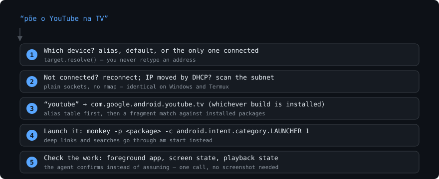

# Tutorial: ten minutes from zero to a controlled device

Assumes [adb and adb-ai are installed](INSTALL.md) and debugging is on.



- [Finding your device](#finding-your-device)
- [Pressing buttons](#pressing-buttons)
- [Opening apps](#opening-apps)
- [Typing without the on-screen keyboard](#typing-without-the-on-screen-keyboard)
- [Knowing what is going on](#knowing-what-is-going-on)
- [Several devices](#several-devices)
- [Scripting it](#scripting-it)

---

## Finding your device

```bash
adb-ai scan
```

adb-ai opens a socket to port 5555 on every address of your subnet, in
parallel. Takes a couple of seconds and needs no nmap, no root, no extra
package — the same code runs on Windows and on a phone.

```console
$ adb-ai scan
192.168.0.42:5555
```

Connect, and give it a name you will remember:

```bash
adb-ai connect 192.168.0.42 --alias tv
```

`--alias` also makes it the default device, so from now on you can leave `-d`
out entirely. The alias is stored in `~/.config/adb-ai/config.json`
(`%APPDATA%\adb-ai\config.json` on Windows).

**Your router will move that address.** It is DHCP: the TV that was `.102`
yesterday can be `.115` today. You do not have to care — when a command finds
the stored address unreachable, run `adb-ai scan` again and reconnect. That is
the whole maintenance story.

---

## Pressing buttons

```bash
adb-ai key home
adb-ai key down down ok      # a sequence, left to right
adb-ai key volup -n 5        # repeat
adb-ai keys                  # every name there is
```

Names are the ones you would say out loud: `home`, `back`, `ok`, `up`, `down`,
`left`, `right`, `play`, `pause`, `playpause`, `next`, `prev`, `forward`,
`rewind`, `volup`, `voldown`, `mute`, `power`, `sleep`, `wake`, `menu`,
`search`, `settings`, `guide`, `info`, `channelup`, `channeldown`, `input`,
`captions`, the digits `0`–`9`, and the coloured TV keys `red`, `green`,
`yellow`, `blue`.

Any raw Android keycode works too, so nothing is out of reach:

```bash
adb-ai key KEYCODE_BOOKMARK
```

---

## Opening apps

```bash
adb-ai open netflix
adb-ai open youtube
adb-ai open com.spotify.tv.android     # full package name
adb-ai open youcine                    # a fragment is enough
```

Three strategies, in order: an exact package name, the built-in alias table
(which prefers the TV build of an app over the phone one), then a fragment
match against what is actually installed. If a fragment matches several
packages, adb-ai lists them and asks you to be specific instead of guessing.

See what you have:

```bash
adb-ai apps           # third-party apps
adb-ai apps --all     # system packages too
```

Missing an alias for the service you use? Add it to `ALIASES` in
`adbai/apps.py` and send a pull request — that table is meant to grow.

---

## Typing without the on-screen keyboard

Typing on a TV with a remote is miserable. Don't.

```bash
adb-ai youtube "lofi hip hop radio"
```

That builds a YouTube search URL and fires it as an intent, so the app opens
straight on the results.

For anything else, a deep link does the job:

```bash
adb-ai url "https://www.netflix.com/title/80100172"
adb-ai url "spotify:playlist:37i9dQZF1DXcBWIGoYBM5M" --app com.spotify.tv.android
```

And when a text field really does have focus:

```bash
adb-ai text "hello there"
```

(Spaces and quotes are escaped for you — `input text` is picky about both.)

---

## Knowing what is going on

```console
$ adb-ai state
device:     192.168.0.42:5555
foreground: com.netflix.ninja/com.netflix.ninja.MainActivity
screen:     Awake
playback:   playing
```

One call answers three questions: which app is in front, whether the screen is
on, and whether media is **actually** playing. That last one matters — an app
being open says nothing about whether it is playing.

```bash
adb-ai state --json      # for scripts
adb-ai shot screen.png   # when you want to see it
adb-ai shot - > out.png  # straight to stdout
```

Two quirks worth knowing:

- Right after switching apps, `foreground` can read `unknown (transition?)`.
  Wait a second and ask again — it is not a failure.
- Some devices print driver noise before the PNG in a screenshot. adb-ai always
  cuts to the PNG header, so `shot` gives you a valid file even then.

---

## Several devices

```console
$ adb-ai devices
192.168.0.42:5555  [device]  Living Room TV  (default, tv)
192.168.0.60:5555  [device]  Mi Box          (quarto)
R58M123ABCD         [device]  Galaxy Tab A8
```

```bash
adb-ai alias quarto 192.168.0.60      # name one
adb-ai alias                           # list the names
adb-ai -d quarto key pause             # act on it once
adb-ai use quarto                      # or change the default
```

`ADBAI_DEVICE=quarto` works too, which is handy inside a script.

---

## Scripting it

Everything is exit-code honest (`0` ok, `1` failure) and the interesting
commands take `--json`, so ordinary shell works:

```bash
#!/usr/bin/env bash
# Movie night: wake the TV, open Netflix, make sure it is really playing.
set -e

adb-ai on
adb-ai open netflix
sleep 3
adb-ai key ok

if [ "$(adb-ai state --json | python -c 'import json,sys; print(json.load(sys.stdin)["playback"]["state"])')" = "3" ]; then
  echo "playing"
else
  echo "not playing — check the screen" >&2
  adb-ai shot /tmp/tv.png
fi
```

Prefer to use it as a library? It is plain Python:

```python
from adbai import actions, target

tv = target.resolve("tv")
actions.open_app("netflix", serial=tv)
print(actions.state(tv))
```

---

Next: [hand it to an AI agent](AGENTS.md), or read
[how it works](HOW-IT-WORKS.md).
